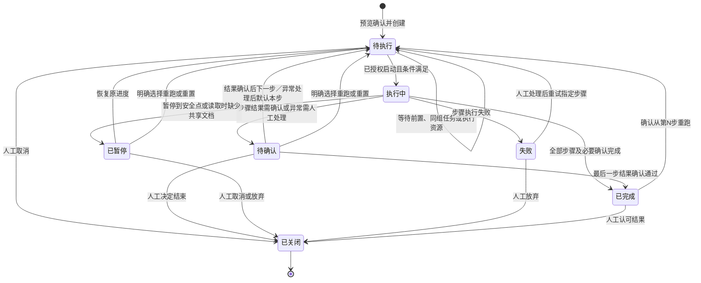

# beivymate 完整产品设计说明书

> 文档版本：统一设计稿 v1.1  
> 整理日期：2026-10-21；统一修订：2026-10-23  
> 产品形态：独立安装、数据本机保存的客户端  
> 适用目标：首个可交付版本，以及后续分模块实施与验收  
> 实现核对基线：`feature/model-setting`，提交 `cfe3523`（已回退至本地主分支代码）  
> 本文整理产品目标，不表示所有能力已经实现。本次仅编写文档，不修改业务代码。

## 阅读说明

**本次统一基线：2026-10-23 最新会话澄清。** 人工关闭、7 状态、组内串行、局部重跑替换、读取证据和受控模型调整以本文最新条款为准。[任务两图](TASK_FLOWS.md) 为配套表达；附件稳定稿的旧文字不得覆盖本次更新。

本文整合历次已确认约定、仓库架构规范、现有 UI 和附件设计。附件中的 OmniAlba 均指本产品 beivymate；本文统一使用 beivymate。

规则优先顺序：用户后续明确确认的约定 → 本次适用的架构规范 → 原流程设计附件 → 历史设计和演示。旧实现与新设计不一致时，应记录缺口，不能把旧实现当作新需求，也不能把设计描述当作实现证明。

文中“目标设计”表示后续开发应达到的行为；“建议／待确认”表示尚未形成最终约定。未明确决定的事项在末章集中列出，不以本文代替用户确认。

本文不重新设计已经完成的页面。**模型设置及其他现有 UI 是实施基线，接通后端时保留其布局、视觉和操作习惯，只增补业务所需的少量控件。** 上一轮模型模块改动已经回退，其测试结果与能力不属于当前代码的交付证据。

## 目录

1. 产品定位与范围
2. 用户与使用场景
3. 信息架构与交互原则
4. 核心业务对象
5. 端到端使用流程
6. 模型配置
7. 技能中心
8. 工作流
9. 工作区
10. 我的任务与任务执行
11. 任务 Chat
12. Knowledge 与输入管理
13. 输出文件与运行记录
14. 通知与分析统计
15. 账户、权限与安全
16. 本地存储与架构边界
17. 异常、恢复与非功能要求
18. 验收标准与完整业务场景
19. 当前实现与待开发范围
20. 开发与交付方式
21. 旧设计覆盖说明
22. 待确认事项
23. 设计依据与追溯

## 1. 产品定位与范围

### 1.1 产品定位

beivymate 帮助用户把工作方法整理为可复用技能，把技能编排成工作流，再在具体工作区中创建任务并执行。用户通过任务提供资料、检查结果、处理确认事项，必要时通过对话获得协助。

核心关系：**工作区提供业务范围，任务承接输入与执行，工作流组织步骤，技能完成每一步。**

产品优先服务不熟悉代码的用户：普通配置采用表单、Markdown、路径选择和输入来源下拉，不要求编写脚本、JSON 或复杂连线图。

### 1.2 首版必须形成的闭环

产品是职业工作者的助手，重点减少重复和整理性工作，并发挥模型分析、总结能力。系统说明事实、风险和影响，用户承担业务判断；不靠复杂状态、自动失效传播或额外审批替代专业决策。仅保留输入可用、前置完成、同组串行、安全暂停和关闭后只读等必要约束。起始步骤由用户决定，系统不擅自推断应从哪里重跑；现有规则不允许的操作应阻止并说明原因，不自动恢复任务或悄悄使用失效资料。


配置模型 → 准备并发布技能 → 准备并发布工作流 → 创建工作区 → 创建任务并检查输入 → 执行与确认 → 查看／保存客户文档 → 完成并由人关闭任务。

在此前提下补齐本机通知、默认模型继承、只读 Chat、导入导出及关键异常恢复。更高阶对话操作按独立验收项逐步接入。

### 1.3 产品边界

| 范围 | 设计要求 |
|---|---|
| 安装使用 | 每位用户独立安装，本机服务支撑客户端界面 |
| 数据归属 | 配置、任务、知识索引、附件和产物在用户本机 |
| 资源分享 | A 导出技能／工作流包，B 导入后在自己机器验证与发布 |
| 模型连接 | 可连接用户配置的远程模型服务或本地推理服务 |
| 本地数据的含义 | 本机存储不等于全部离线；调用远程模型会发送本次请求所需的资料 |
| 不引入 | 团队服务器、在线同步、共享多租户数据库、模板库模块 |
| 不承诺 | 任意外部技能导入即可安全执行；任意脚本／原生模型协议无需适配即可运行 |

## 2. 用户与使用场景

### 2.1 用户角色

- 工作执行者：选择工作区和工作流，提交资料，处理人工确认，获取结果。
- 工作方法维护者：新建或导入技能，编排工作流，校验并发布可复用能力。
- 本机配置维护者：配置模型、目录、默认项及个人设置。

同一个本机用户可兼任上述角色。测试、开发、产品等角色用于组织能力和权限，不代表已经具备团队协同服务。

### 2.2 典型场景

1. 测试人员导入已有需求理解技能，在 HIS 工作区提交需求，依次生成需求理解、测试分析与测试用例。
2. 用户把公司特有的方法整理为自定义技能，分享给另一名同事；接收者在自己电脑重新验证和发布。
3. 大多数技能和对话使用一个通用模型；模型价格或可用性变化时，用户只修改默认模型。
4. 用户运行长流程，在需确认的环节暂停；确认后继续，退出页面不取消已经接受的执行。
5. A 工作区任务完成后，已授权的关联 B 任务可自动开始；关闭由人判断，显式共享资料按任务输入登记。

## 3. 信息架构与交互原则

### 3.1 导航结构

| 区域 | 入口 | 核心职责 |
|---|---|---|
| 工作台 | 我的任务 | 跨工作区待办、任务提醒、未关闭任务处理 |
| 工作台 | 工作区 | 展开具体工作区，进入对应助手与任务列表 |
| 工作台 | 我的工作区 | 工作区卡片、新增、查看、编辑及启停 |
| 工具 | 技能中心 | 技能包发现、新建、导入、查看、验证及发布 |
| 工具 | 工作流 | 编排、输入来源、发布与使用情况 |
| 工具 | 分析统计 | 任务统计、执行与模型用量分析 |
| 账户区域 | 我的账户／个人设置 | 账户资料、默认目录、模型配置、退出 |

工作台与工具两个 label 保留；账户区域、品牌与已确认菜单风格不随模块后端改造而变动。

### 3.2 页面与视觉约束

- 保持现有绿灰配色、柔和背景、圆角、表单必填标识和按钮规范。
- 一级页面紧凑排列，避免重复的顶部 title 与大面积无意义留白；已去掉的刷新入口不重新加入。
- 技能中心、工作流、我的工作区的标题右侧操作按钮保持一致。
- 工作区助手使用固定高度和内部滚动；输入区位置与高度沿用已确认布局。
- 问候按本机时间分段，并为每段准备多条亲切话术；不以随机文案替代真实任务数量。
- checkbox 鼠标选择不出现异常外框；键盘操作保留可辨认的焦点反馈。
- 图标、字号和对齐沿用当前 UI；新功能优先嵌入原组件，不能借接通后端整体重做。

### 3.3 时间问候

| 时段 | 时间范围 | 示例 |
|---|---|---|
| 早上 | 07:00–11:30 | 早上好！新的一天，我们先把手边的工作安排好。 |
| 中午 | 11:30–13:00 | 中午好！辛苦啦，有需要确认的事情我会帮你记着。 |
| 下午 | 13:00–18:00 | 下午好！我们接着把今天的工作往前推进。 |
| 晚上 | 18:00–次日 00:00 | 晚上好！今天辛苦了，看看还有哪些事情需要你的协助。 |
| 凌晨 | 00:00–07:00 | 夜深了，辛苦啦。需要处理的事情都在这里，按自己的节奏来。 |

无遗留任务时明确表达“暂时没有需要继续处理的任务”；存在待确认、失败等情况时，说明数量和可操作事项，不使用责备语气。

## 4. 核心业务对象

| 对象 | 定义 | 主要关系 |
|---|---|---|
| 模型厂商／来源 | 模型服务连接、协议与凭据引用 | 一个来源对应多个模型 |
| 模型 | 可调用的具体模型及能力、费用和启停配置 | 被 Chat 或技能执行选择 |
| Skill | 原子工作能力，包含指令和静态附属资源 | 被工作流步骤引用 |
| Workflow | 有序技能步骤及输入绑定 | 被任务实例化 |
| Workspace | 产品／项目业务范围与 Knowledge 容器 | 拥有多个独立任务 |
| Task | 一次具体工作的业务实体 | 归属一个工作区，实例化一个工作流 |
| 运行／尝试 | 某任务的一次执行过程 | 属于任务，保存检查点、快照、日志与产物 |
| 任务关系 | 仅关联，或前后置顺序关系 | 不建立跨任务产物数据流 |
| 会话 | 工作区／任务中的协助对话 | 保存消息与独立模型偏好 |
| 产物 | 某任务某次运行某一步产生的文件或数据 | 保存来源、确认状态及实际存放位置 |

用户无需管理工作流／技能版本号。系统内部仍保留稳定 ID、内容指纹和运行快照，以便恢复和审计；内部信息不能演变成用户必须维护的版本流程。

## 5. 端到端使用流程

### 5.1 首次使用

1. 安装并启动客户端，初始化本机账户后登录。
2. 进入后端保存的默认工作区；尚无工作区时进入创建引导，不生成虚假业务数据。
3. 设置至少一个可用模型，并选择通用默认与默认 Chat 策略。
4. 使用已校验的内置资源，或导入／创建技能并验证、发布。
5. 创建并发布工作流，配置各步输入来源。
6. 创建工作区，填写产品／项目与 Knowledge 目录。
7. 创建任务，在解析后预览中核对输入、Knowledge、模型、确认方式及输出位置。
8. 确认启动；在任务详情或我的任务中继续处理。

### 5.2 日常使用

登录默认工作区 → 查看助手提醒 → 新建任务或处理待确认项 → 查看执行结果 → 人工判断完成、放弃与关闭；关联成员完成后可按授权自动接力，不等待关闭。

### 5.3 分享与接收

A 导出包 → 传递文件 → B 导入 → 查看兼容性报告 → 待验证 → 本机验证 → 本机发布 → 才能用于工作流或新任务。

导出包中的“已发布”声明、A 的账户、密钥、绝对路径、任务记录不能成为 B 的可信配置。

## 6. 模型配置

### 6.1 UI 基线

保留现有“模型管理／成本控制／高级配置”三个页签，以及厂商分组表格、三步新增厂商、平台导入、模型编辑／能力校准、主备顺序编辑等现有设计。

新增默认设置采用与原页面一致的紧凑区域，不替换模型列表，不重新组织页面。

### 6.2 模型来源与模型信息

来源包括官方直连、聚合平台、模型平台、公司本地和自定义。来源类型是组织信息，不能被当成已支持相应协议的证明。

| 配置对象 | 主要字段 |
|---|---|
| 来源 | 名称、来源类型、API 协议、服务地址、鉴权方式、自签名证书设置、启停 |
| 凭据 | 密钥／令牌或适配器所需凭据；通过安全接口保存，不回显原值 |
| 模型 | 服务端模型 ID、显示名、来源标注、上下文、能力、推荐档位、计费方式、单价及单位、启停 |
| 能力校准 | 声明能力、依据、校准时间与记录；人工声明与实际测试区分 |

协议与鉴权必须按实际适配范围展示。不支持的选项明确标记，不允许保存成功后才伪装为已连接。发现接口不支持时允许手动注册模型。

### 6.3 默认模型与跟随设计

| 设置 | 行为 |
|---|---|
| 通用默认模型 | 大多数用户维护的统一模型入口 |
| 默认 Chat 模型 | 可跟随通用默认，也可单独指定 |
| 技能默认模型 | 可跟随通用默认；是否独立展示覆盖入口沿用最小改动原则 |
| 对话选择 | 跟随默认 Chat，或为当前对话显式指定 |
| 技能／步骤选择 | 跟随默认，按档位，或显式指定；不需要模型的步骤可声明不用模型 |

“跟随默认”保存的是继承关系，不是把当前模型 ID 复制到每个对象中。

- 换通用默认后，跟随者的后续消息及新准备的运行使用新模型。
- 显式指定的对象不被批量覆盖。
- 改默认不改写已执行步骤或历史模型记录；用户通过安全暂停后的受控替换，可调整尚未执行步骤的模型。已执行步骤需改模型时必须显式重跑。
- 修改默认引用与修改被引用模型本身是两件事；后者仍受未关闭任务保护。
- 切换前显示影响说明：哪些用途跟随、哪些显式配置保留，哪些任务需要安全暂停、重置或手工处理；不改写已发生的执行记录。

### 6.4 模型解析

技能步骤：任务对该步骤的显式覆盖 → 工作流步骤覆盖 → 技能偏好 → 技能用途默认 → 通用默认。按档位选择时先解析档位主模型，再应用能力与最低档位约束。

Chat：当前对话显式选择 → 默认 Chat 模型 → 通用默认。Chat 选择不修改技能、工作流或任务执行模型。

模型解析还须检查：模型与来源启用、凭据可用、所需能力、输入规模及允许的调用范围。没有合适模型时明确阻塞，不能仅因名字相似替代。

### 6.5 发现、测试与故障转移

- 发现读取真实服务目录，不生成演示模型，不根据名称猜测价格或能力。
- 测试实际发出调用，显示失败原因；文本成功不代表结构化、视觉或工具调用全部通过。
- 主备顺序、同档／跨档策略、重试次数、超时和触发条件由后端执行。
- 只对配置允许的错误转移；鉴权、输入契约、权限等错误不能用换模型掩盖。
- 备用模型必须满足能力与最低档位要求；所有候选失败后保留原因。
- 实际使用的模型和切换原因进入运行／消息记录。
- 演练可以保留，但必须明确为模拟，不能充当真实连接成功证据。

### 6.6 成本与保护

实际调用记录用量、模型、耗时、结果与估算费用。缺少价格或供应商用量时显示未知，不补造数据。沿用 UI 明示的计费单位，统一换算，严禁混用每千和每百万 Token；币种分开显示。

预算先提供提醒，不暗示会自动停止任务。费用估算不替代厂商账单。

未关闭任务引用的模型、厂商连接及相关执行配置原则上不能修改、删除、停用或替换凭据。模型引用快速替换是明确授权的受控例外，不等于允许编辑内置包、改变工作流定义或解除其他任务引用锁。

### 6.7 模型快速替换

沿用模型库，在模型行提供“替换为…”：源模型 → 目标模型 → 影响对象及范围预览 → 能力／最低档位／启用／鉴权校验 → 用户确认。能力不满足的对象不能强制替换。

跟随默认的对象通过默认配置继承；显式引用对象列入影响清单。待执行任务重新解析目标模型；其他未关闭任务提示“一键重置／请求安全暂停／手工处理”。一键重置也必须先展示清理范围，并等当前步骤到达安全点。

安全暂停后，新模型仅用于尚未执行步骤；已执行步骤及其记录不变。若希望已执行步骤也使用新模型，选择对应步骤重跑。已关闭任务只读。保存由后端按任务及步骤受控处理，不能通过批量编辑包文件绕过保护；其他引用任务仍须逐项校验。

记录源、目标、范围、时间及处理结果。首版不设计反向替换或撤销。

## 7. 技能中心

### 7.1 技能包结构与兼容目标

兼容目标以用户已有 WorkBuddy、OpenClaw 技能为主，同时尽量接收其他采用 `SKILL.md` 入口的包。具体生态的加载、工具和执行能力分别验证，不能宣称存在完全统一的执行标准。

```text
skill-name/
├── SKILL.md                    入口、说明与执行指令
├── contract.md                 可选的平台输入／输出契约
├── references/                 可选的参考资料
├── assets/                     可选的静态素材
│   └── templates/              可选的生成模板
├── scripts/                    可选脚本，不因导入而执行
└── examples/                   可选示例
```

兼容接收已有 `reference/`、`references/`、旧 `templates/` 等目录时，不静默改名破坏包内链接；适配或迁移应明确说明并保留原包。

- 通用入口字段与产品扩展分开处理；保留未知扩展，不能要求外部包必须有本产品 executor。
- 没有平台契约时，允许导入和查看；是否能够接入编排，须由能力与契约适配结果决定。
- 普通指令型技能可采用通用指令运行路径；工具／脚本型技能需适配相应执行能力和权限。
- executor 是内部实现选择，不应成为非 IT 用户必填的技术概念，也不能作为兼容所有外部包的前提。
- 包格式合规、可安全加载、可执行、输出契约满足、模型连通与业务质量是不同检查层次。
- `skill-v1.3.0` 作为目标包设计参考；其中写回包目录、执行脚本和发布声明等条款按本文后续约定处理。

### 7.2 存放与来源

| 来源 | 位置与管理 |
|---|---|
| 系统内置 | `src/beivymate/builtin/skills/`，随软件发行，只读 |
| 新建／复制 | 用户数据目录 `skills/`，位于源码／安装目录外 |
| 外部导入 | 同一自定义技能根，由后端校验、保存与索引 |
| 直接复制包目录 | 后端扫描发现，建立本机状态记录；不能直接引用 |

开发环境可配置源码外的 skills 目录；正式产品不依赖用户向安装目录写数据。前端只展示后端返回的技能，不保存权威技能列表。

### 7.3 页面与操作

卡片保留图标、名称、描述、来源、角色、状态、工作流引用、未关闭任务引用和真实调用信息。已发布且可用时显示“已发布·工作流可用”；未满足条件时显示原因。

支持查看文件树、新建、复制、目录／包导入、验证、发布、停用、导出及引用详情。内置资源只能查看和另建副本；删除入口的首版范围见待确认事项。

### 7.4 状态与发布

| 状态 | 含义 | 可被工作流新引用 |
|---|---|---|
| 待验证 | 新建保存、复制、外部导入或检测到内容变化，尚未通过本机验证 | 否 |
| 验证失败 | 格式、资源、契约或支持能力存在问题，展示原因 | 否 |
| 已验证 | 当前内容通过本机检查，尚未发布 | 否 |
| 已发布 | 用户明确发布且发布指纹与当前内容一致 | 是，仍须满足角色与运行条件 |
| 已停用 | 不能供新引用／新执行使用，历史保留 | 否 |
| 草稿 | 当前架构仍保留的编辑阶段状态；是否与待验证合并尚需最终确认 | 否 |

正式包状态不信任包内的发布声明。发布记录保存在本机并绑定完整内容指纹；修改任一影响包内容的文件后，原验证与发布资格失效。

已验证不等于用户认可业务质量；仍需试运行／样例验收。外部脚本不在静态验证阶段自动执行。

### 7.5 引用保护与分享

任一未关闭任务直接或经工作流引用技能时，禁止修改、删除、停用、替换模板或资源。允许查看、导出与创建独立副本。锁定详情必须列出任务，不能只显示不可点击按钮。

导出包含完整静态包，不包含本机可信发布记录、运行日志、任务数据或凭据。接收方导入为待验证。同 ID 冲突须明确提示，更名或创建副本，禁止静默覆盖。

## 8. 工作流

### 8.1 基本信息与类型

内置工作流只读，自定义工作流可新建或从现有工作流复制。记录稳定 ID、名称、描述、适用角色、步骤、输入绑定、确认模式、模型覆盖和输出规则。

用户不维护版本号；任务实际使用的工作流快照由系统自动保存。

### 8.2 编排界面

保留现有工作流列表、搜索与状态筛选，样式与技能中心一致。编排采用有序步骤卡片，不引入复杂节点连线图。

每步展示技能、输入来源、输出、模型、深度策略（适用时）、确认模式。只可选择当前用户可使用且已发布的技能。

### 8.3 输入 wiring

每个输入使用一行：`输入名称 ← 来源`。

来源只有：任务输入、前序步骤输出、固定值；技能默认值在未被有效覆盖时提供默认内容。

1. 前序同名输出可以自动匹配，但须展示来源与“自动匹配”标识。
2. 显式任务输入优先；不因自动匹配覆盖用户输入。
3. 不得引用后续步骤；禁止循环和引用其他任务的产物。
4. 删除／移动步骤后，失效绑定标红；处理完之前不能发布或执行。
5. 来源为任务输入且无有效默认值的必填字段，进入任务创建表单。
6. 前序输出尚未产生是“运行时待生成”，不能误判为用户漏填。
7. 输出格式和输入契约不兼容时阻止绑定，不能仅按同名强行匹配。

### 8.4 确认模式

| 模式 | 行为 |
|---|---|
| 自动通过 | 输出通过系统契约检查后自动继续，记录决策 |
| 人工确认 | 暂停后续步骤，等待用户确认本步输出 |
| 通知 | 继续执行并发送本机通知，不要求另一名团队成员在线 |

任务可按步骤覆盖工作流确认方式。Knowledge 冲突、必要权限或高风险操作需要的确认不能被自动模式绕过。

人工确认有两类：工作流配置的步骤间结果确认，以及异常需人工介入。确认与重新执行无关联：接受本步结果后进入下一步；异常处理后，用户确认继续时默认从异常本步执行，也可选择更早步骤；不主动选择起始步骤时用本步默认值，不默认跳到下一步。重新执行、重置、中止是独立动作。跳过只在明确允许且必需输入仍满足时可用。对实际操作外部系统的技能说明重跑所需的数据清理／环境恢复；文档生成步骤不增加无关确认。

### 8.5 生命周期与使用保护

采用待验证、验证失败、已验证、已发布、已停用等同类生命周期。发布检查所有技能资格和输入闭环；创建任务与准备执行时再次校验。

只要存在未关闭引用任务，禁止编辑、删除、停用或更换步骤配置。内置不可原地修改。允许复制为独立工作流。

工作流导出可以携带依赖技能，或生成明确的依赖清单；具体打包形式尚待确认。无论哪种方式，导入端都重新验证依赖，不信任来源机发布状态。

## 9. 工作区

### 9.1 字段

| 字段 | 输入方式与约束 |
|---|---|
| 标识／简称 | 用于展示与定位，需唯一；系统内部身份不能因改名而丢失 |
| 工作区名称 | 面向用户的名称 |
| 工作区描述 | 可编辑多行文字，卡片单行超出省略 |
| 覆盖产品 | 用户主动输入多个标签，回车添加，可移除；不是预置选项 |
| 覆盖项目 | 同上，可输入多个 |
| Knowledge 来源 | 多个目录路径；校验可读性与有效范围 |
| 默认工作区 | 放在表单最下方；登录后优先打开 |
| 客户产物目录 | 保留现有支持，作为任务未单独指定时的输出位置 |

### 9.2 卡片与主页

卡片沿用已确认设计：彩色简称图标，旁边两行简称与名称，启用状态与图标居中对齐；名称尽量单行，必要时省略或换行。显示描述、产品／项目、Knowledge、默认标记、未关闭独立／关联任务数和操作。

操作包括打开、编辑、停用、启用。进入工作区显示标识与名称、固定高度助手区、统一高度任务行和下方输入区。

### 9.3 修改与启停

- 存在任何未关闭任务时，不可编辑或停用；已完成但未关闭仍阻止修改。
- 全部任务关闭后，允许修改工作区全部可编辑内容，包括显示简称。
- 若当前简称也是内部 ID，改简称时须非破坏性更新关联；不能创建悬空任务或丢失历史。
- 停用保留历史，不允许新增任务或开始执行；重新启用不删除记录。
- 停用对话框中暂停图标在左、标题与说明在右，沿用现有色彩和留白。
- 默认工作区必须可进入；停用默认工作区时需先选择替代，或明确回到工作区列表。

## 10. 我的任务与任务执行

### 10.1 我的任务页面

跨工作区显示需要继续处理的任务，按“工作区标识＋名称”分组。任务提醒采用助手对话样式，列表位于提醒区域内，不再重复展示“待完成任务列表”标题。

标题右侧保留紧凑状态卡片“待完成任务”：第一行状态与明显数字，第二行工作区分布。完整统计移至分析统计模块。数量来自真实后端，演示数据不得进入正式界面。

“待完成”区域在业务上用于处理尚未关闭的工作；已完成待关闭应可找到，不能因执行已结束而消失。

### 10.2 创建任务与输入入口

任务归属一个工作区，选择一个工作流。包括任务名称、结构化必填输入、需求说明、附件／补充资料、Knowledge 范围、模型覆盖、确认方式、输出位置、优先级与关联关系；关闭统一由人操作。

所有业务输入经任务登记。Chat 中补充的内容须经确认转入任务输入；工作流内部步骤输出是同一任务的数据流，不是新的外部输入入口。

从工作区输入框开始时，先带入草稿，再展示结构化任务表单供确认；不能收到一句话即隐式启动收费调用。

### 10.3 执行前预览

1. 输入值、来源、必填性和就绪状态。
2. 工作区 Knowledge 根目录、所选子路径、可读取文档数量及任务补充文件。
3. 各步解析后的模型与覆盖来源，缺失能力／鉴权提示。
4. 人工确认方式及任务覆盖项。
5. 主要客户文档与实际输出位置。
6. 仅关联／前后置任务，以及尚未完成的前置任务和组内占用情况。
7. 权限、外部副作用与需要用户确认的事项。

准备检查与真正开始执行分离；预览阶段不调用模型生成业务结果、不伪装为运行中。

### 10.4 面向用户的 7 个状态

| 状态 | 含义 | 用户可做的事 |
|---|---|---|
| 待执行 | 已创建、已申请继续／重跑，或等待前置、同组任务、执行资源 | 启动、修改输入和优先级、人工取消关闭 |
| 执行中 | 正在执行步骤 | 查看、请求安全暂停、在 Chat 登记补充资料；不能修改优先级 |
| 待确认 | 步骤结果确认或异常人工处理 | 确认、处理异常；独立选择重跑／重置／结束，允许修改优先级 |
| 已暂停 | 已到安全点，不再调度后续步骤 | 恢复、重跑、重置、模型受控调整或人工关闭，允许修改优先级 |
| 失败 | 当前步骤失败，等待人工判断 | 处理后重试、决定接受／放弃／关闭，允许修改优先级 |
| 已完成 | 全部步骤及必要确认结束，尚未关闭 | 查看、从指定步骤重跑、人工关闭，允许修改优先级 |
| 已关闭 | 唯一终态 | 只读查看、导出、复制为新任务；不能修改优先级或重新执行 |

不另设排队中。等待原因作为待执行附属说明。暂停请求、安全点、放弃标记和人工接受失败是动作／记录，不增加顶层状态，也不伪造技术执行成功。

优先级仅供用户查看和列表排序，排序组合为“创建时间＋优先级”，不参与执行顺序、业务判断或抢占。只有执行中和已关闭不能修改。

### 10.5 任务状态图与动作图

完整动作图见 [任务动作流程](TASK_FLOWS.md#一任务动作流程)。两个图遵守同一状态规则。



确认、恢复、重试和重跑先经过待执行条件检查；条件立即满足时可以直接开始，但不能在排队时显示执行中。已关闭没有重开箭头。

### 10.6 人工判断与关闭

不设计自动关闭。独立任务由人决定正常完成、主动取消或失败后放弃。关联任务的完成、接受失败结果、放弃、是否继续及关闭范围交由人判断；提供成员／组级确认入口，不强制全组技术成功才允许结束。

系统展示真实状态和影响，不替人推断业务认可。人工业务判断与步骤技术结果分别记录；失败不能仅因用户认可而改写成模型／工具执行成功。关闭范围内不得有正在执行步骤；先到安全点，处理待启动或重跑请求，再确认关闭。成员关闭只解除其引用；仍有其他未关闭引用时配置继续受保护。

关闭前比对共享文档、Knowledge 当前内容与各步实际使用证据：黄色＋文字提示资料已更新，红色＋文字提示来源丢失／无法核实，正常与未使用分别标识。由人选择接受、重跑或放弃，不自动判定结果失效。关闭后只读、不可重开，关闭本身不删除文件和证据。

### 10.7 安全暂停、恢复、局部重跑与重置

执行前顺序统一为：选定起始步骤 → 检查输入、模型、路径及清理范围 → 展示影响并由用户确认 → 清理对应旧结果 → 开始新执行。检查未通过时提示用户处理，不先删后查。系统不替用户决定业务上的最佳起始步骤，也不因资料变化自动扩大重跑范围。


不强行打断正在执行的步骤。暂停请求先登记，当前步骤到达安全点后停止后续调度。若步骤失败或出现需处理事项，显示失败／待确认；若已完成最后一步，则进入已完成，不为暂停请求制造多余执行。

普通恢复沿用原有效结果和进度，不删除文件。局部重跑必须由人明确选择当前可重试步骤或更早步骤 N，不能跳过未执行步骤。确认通过不触发重跑。

局部重跑的唯一口径：

- 保留 1…N−1 的有效输出与确认，作为本次前序输入。
- N 及之后的旧过程结果、客户文件、对应历史结果／确认失效并按登记范围清理，由本次新执行替换，不沿用其旧结果；新执行失败也不能回退旧结果冒充成功。
- 不删除前序有效结果、任务原始输入、其他任务文件或同目录无关文件。清理仅操作本任务对应步骤的登记文件。
- 保留前序输出再次被使用时，在本次步骤下记录实际读取内容、摘要、来源和读取时间。
- 重置等于 N=1，全部步骤重新执行。删除只发生在用户明确确认重跑／重置后，不是页面恢复、普通继续或关闭的副作用。
- 对外部系统已发生的操作，删除文档不会撤销操作；由相关技能说明是否需清理测试数据／恢复环境，用户决定。纯文档生成无需额外泛化限制。

例：需求理解 → 测试分析 → 测试设计 → 测试执行。从测试分析重跑，保留需求理解，替换测试分析、测试设计和测试执行结果，执行到结束。

### 10.7.1 失败修复与本期范围

技能或工作流本身出错时任务为失败，说明原因。问题修复后，由用户选择起始步骤，沿失败恢复流程执行。用户“确认继续”表示继续处理当前任务，不表示将失败前置视为完成或允许后置越过前置。

原任务更换工作流属于后续新需求，本期不提供，不通过复制／换绑工作流暗中扩大本期范围。未关闭任务引用锁与必要配置修复入口如何衔接，记录在开发待办，实施该模块前再确认；本设计不宣称该入口已经实现，也不自动解除配置锁。

### 10.8 关联任务组与接力

一个任务最多属于一个组，采用主任务／关联任务，不使用子任务概念。只显示直接关联与链接，不递归汇总结果。

| 关系／场景 | 规则 |
|---|---|
| 仅关联 | 无业务先后要求，但组内仍串行；自动选择采用稳定顺序，不受优先级影响 |
| 前后置关联 | 以前置完成为门，不等待关闭；前置未完成不得启动后置，失败修复后从本步或用户选择步骤执行 |
| 同组 | 任一时刻只有一个成员实际执行，人工启动和重跑同样遵守 |
| 不同组／独立任务 | 可并行，受本机执行资源限制 |
| 同任务步骤 | 正常消费前序输出 |
| 跨任务资料 | 不自动登记输入；允许用户显式登记关联共享文档，读取最新逻辑文档并留证 |

A 已完成、B 正在执行时，A 重跑先等待 B 结束或到达安全暂停点，再由用户决定切换执行哪个成员。组内等待确认／暂停可以释放本机执行槽给其他组，但不自动放行本组下一个成员；用户明确切换后仍保证同组只有一个实际执行。

自动执行开启时，成员完成事件触发后继检查：输入完整、所需前置完成、工作区可用、配置可执行、组内资格及资源满足，才开始；否则待执行并说明原因。自动执行关闭时通知人手动启动。前置未完成时，后置启动按钮不可用，后端同样拒绝；人工认可、继续、放弃或关闭动作都不构成绕过完成条件的授权。状态变更与启动幂等，重启不重复执行。

### 10.9 显式共享与解除关联

关联任务可显式引用对方工作区允许范围内的 Knowledge。主任务可将产出文档共享，文档归来源任务；关联成员显式登记为自己的补充输入，引用逻辑文档，后续读取最新内容。没有关联不能继续新读取，历史实际使用证据仍可追溯。

引用任务执行到需要共享文档的位置时读取来源任务当前有效文档；没有或不可读时暂停并提示缺失文档及来源，补齐后由用户继续。读取前尚无正在执行操作时可以立即暂停；已经在执行的操作仍遵守安全点。不得静默使用失效旧文档，不自动跳过本步。

解除时预览剩余关系和共享资料影响，提示人工重新确认；不改动时默认保留剩余原顺序，例如 A → B → C 移除 B 后默认 A → C。解除使相关共享文档／跨区 Knowledge 的未来引用失效，提示补充或重新登记，缺少必要输入不得执行。

正在执行步骤时不能立即解除，先等待安全结束或请求安全暂停。已关闭任务记录只读，不将其历史输入改成缺失，不删除其读取证据。

## 11. 任务 Chat

### 11.1 定位

Chat 是解释、澄清与协助入口，工作流引擎仍是执行权威。用户不打开 Chat，也能完成自动运行和任务接力。

### 11.2 分阶段能力

| 阶段 | 功能 | 约束 |
|---|---|---|
| 只读协助 | 解释真实任务状态、步骤、失败原因、待确认事项和可访问产物 | 引用实际记录，缺少信息时明确说明 |
| 受控操作 | 补充输入、确认修改、重跑、中止、关闭等 | 先展示操作摘要，用户确认后调用同一业务 API |
| 对话建任务 | 从自然语言整理工作流及必填字段 | 先展示结构化预览，确认后才创建 |

普通聊天不能隐式改变工作流、Knowledge、执行模型或关闭状态。已关闭任务只读。

### 11.3 模型选择与消息

输入框底部左侧提供“对话模型：名称 ▾”，与发送按钮同一行；展开按厂商分组，提供搜索、能力和不可用原因，无模型时提供设置入口。

每个会话保存“跟随默认”或显式模型选择。切换只影响下一条消息，历史消息不重写；助手回复记录实际模型。图片、文件、工具分别检查能力，不能把文本模型当成全能力模型。

聊天记录、模型偏好和确认操作记录保存在本机后端。发送使用唯一请求标识；响应未知时提示核实，不能自动重发导致重复调用或重复操作。

## 12. Knowledge 与输入管理

### 12.1 本次实现范围与未来扩展

本次只做目录选择、单个／多个文件选择和手工填写访问路径。底层统一为“知识来源”：目录型按子路径圈选，条目型按文件列示。拖拽、快捷位置、最近添加、排除清单、笔记、网页、资料包和任务沉淀均为后续增强，不混入本次实施。

工作区可有多个来源，任务默认使用本区范围，可选择子路径／文件；关联成员可显式选择关联工作区范围。根路径校验考虑符号链接，不得任意扩展到其他工作区。跨区引用不额外锁来源工作区，但不绕过该工作区自身的未关闭任务保护。来源停用、范围变化或访问失败明确提示，不能静默扩大授权。

手工访问路径仅作为文件／目录入口；网络共享路径按目标系统实际支持验收，网页链接不在本次范围。

### 12.2 输入、Knowledge 与冲突

任务显式资料与 Knowledge 均按实际读取时的内容使用，不做整个运行级资料冻结。补充资料优先用于本次工作，但实质冲突要列出双方来源并进入待确认，由人判断，不悄悄选边。Chat 新资料必须登记为任务输入。

### 12.3 读取证据与资料变化

后端负责读取、索引、检索和上下文裁剪，不能以目录展示代替检索接通。每次实际读取保存实际使用内容／检索片段、摘要、来源工作区、文件路径／逻辑文档标识、带时区的读取时间、可获得的文件修改时间及片段位置，归任务运行步骤目录。

证据示例：`work/tasks/<task-id>/runs/<run-id>/steps/<step-id>/evidence/reads.json` 与 `contents/`。读取内容与摘要来自同一份实际读取数据；同一步骤请求使用确定的内容，后续步骤可读更新内容。不是冻结未来资料，也不要求用户管理版本。

重跑使用保留的前序输出也建立本次读取证据。第 N 步及之后旧结果和对应历史按重跑清理范围处理；仍有效的前序证据以及未重跑／已关闭任务证据保留。关闭前颜色＋文字提示当前资料与实际使用内容的变化，由人决定接受或重跑。

## 13. 输出文件与运行记录

### 13.1 三类内容

| 类别 | 示例 | 默认归属与位置 |
|---|---|---|
| 技能静态资源 | 指令、模板、参考资料、示例 | Skill 包内，只用于读取 |
| 任务过程资料 | 日志、分析记录、需求理解中间文档、步骤交接数据 | 当前任务／运行的管理目录 |
| 客户交付文档 | 测试用例、测试报告、用户指定的正式文档 | 客户指定目录；未指定时进入默认 deliverables |

一份需求理解文档是否为客户交付物由该技能输出定义与任务选择决定，不能仅根据文件扩展名判断。

**任何任务执行产物都不得写回 Skill 的 assets 目录。** assets 只保存随包发布的静态素材和模板。

### 13.2 建议的管理目录

下面是目标逻辑结构，不要求立即迁移现有数据：

```text
<用户数据目录>/
├── skills/                              自定义静态技能包
├── configuration/                       工作流、模型与用户配置
└── work/
    ├── tasks/<task-id>/
    │   ├── inputs/                      登记的输入与补充资料
    │   └── runs/<run-id>/
    │       ├── snapshot/                工作流定义与执行配置来源
    │       ├── logs/                    脱敏日志与事件
    │       ├── records/                 过程文档与结构化输出
    │       ├── steps/<step-id>/evidence/  实际读取内容、摘要、读取时间
    │       └── checkpoint/              恢复点与审批记录
    └── documents/deliverables/          未指定位置时的客户交付物
```

当前代码已有独立运行目录、文档库和数据库；实施时通过路径服务建立归属关系，迁移保留原目录与历史，不因目录示意图一次移动所有文件。

### 13.3 输出位置与历史

任务指定 → 工作区指定 → 个人默认 → 应用默认 deliverables。明确指定的路径不可写时报告失败，不擅自投递到其他位置。

客户无需指定目录也可执行；默认目录可查看、打开和调整。首次生成防止误覆盖无关文件；用户明确重跑时，按第 10.7 节替换 N 及之后登记结果，前序输出保留，不保留被替换结果作为有效客户文件。

每份有效文件登记任务、运行、步骤、技能、生成时间、路径、格式和内容摘要。有效文件能追溯其来源；重跑被替换范围的旧结果／历史清理，不再承诺保留全部旧结果。最小重跑操作记录仅说明范围、时间与操作者，不保留已经被判无效的客户结果供继续使用。

日志与中间记录由系统自动归档，不默认打扰客户；保留期与清理策略另行确认。客户交付文件不得因普通缓存清理或关闭被自动删除；明确确认的重跑／重置，依第 10.7 节清理对应步骤旧文件。

### 13.4 编辑与确认

修改可编辑文件时记录修改来源；确认绑定实际内容。文件外部发生变化后，不能沿用旧内容的确认结论。

原始执行证据不可任意改写；用户确认重跑范围的旧结果及历史按第 10.7 节清理，而非伪造修改。编辑可读报告不等于重新执行结构化分析；同任务后续步骤采用新结果时通过显式重跑处理；关联任务的已用资料变化在关闭前提示，由人判断。

## 14. 通知与分析统计

### 14.1 本机通知

通知完成、待确认、失败、暂停、状态待核实及前后置等待等事件。至少包含工作区、任务、步骤、时间、原因和跳转入口。

仅本机消息，不引入邮件、短信或团队消息服务。是否扩展操作系统通知另行确认。

通知持久化、去重；收起不等于已读，已读不等于审批。失败和待确认事项不能因为 Toast 消失而无处查找。

### 14.2 分析统计

独立入口承接原我的任务页中的完整统计：按工作区、状态、时间范围统计任务；分析执行成功／失败、待确认、完成与关闭；显示实际模型用量与可计算费用。

仅使用 7 状态统计，排队原因归待执行；“已完成”与“已关闭”分别统计。任务业务数量与运行尝试数量分开，重跑不能虚增为新业务任务。

统计与列表使用相同后端口径，可钻取对应任务。缺少数据时显示空状态或未知，不使用固定演示数。

## 15. 账户、权限与安全

本机初始化、登录、退出和账户恢复沿用现有流程。默认工作区和个人偏好由后端保存。前端角色选择不构成授权。

- API 校验登录身份、角色能力、数据归属和操作合法性。
- 内置资源只读；自定义资源的每个写入口都检查引用锁和修订冲突。
- 密钥存操作系统安全凭据库，不进入浏览器持久化、导出包、日志或运行快照。
- 系统凭据库不可用时明确失败，不降级为明文。
- 导入包防目录穿越、符号链接逃逸、同 ID 覆盖、解压膨胀和不受限文件数量／大小。
- 导入、发现与验证不执行脚本；实际脚本执行须明确权限、运行环境和记录。
- 远程模型服务获得资料的范围应可理解；不能把“本机存储”宣传为“资料绝不离开设备”。

## 16. 本地存储与架构边界

### 16.1 权威来源

| 信息 | 权威来源 |
|---|---|
| 静态技能包／工作流定义 | 后端管理的文件，数据库保存索引与资格 |
| 工作区、任务及关系 | 本机数据库／受控配置服务，保证唯一写入规则 |
| 验证发布资格、引用、业务关闭 | 本机数据库 |
| 运行 | 检查点、调度记录、冻结快照与事件 |
| 附件、产物、Knowledge | 实际文件及其登记／索引 |
| 凭据 | 系统安全凭据库 |
| 浏览器存储 | 交互偏好和未提交草稿，不是正式业务数据 |

### 16.2 引用与事务

创建／更新任务引用与资源修改检查使用相同事务或互斥边界。前端按钮禁用只是提示，后端必须拒绝绕过请求。

系统内部稳定 ID 不因显示名变化而变化。内容指纹标识实际内容；工作流定义与静态模板使用执行配置快照，不能恢复时读取后来改过的包。业务输入与 Knowledge 按每次读取最新内容并留证；受控模型替换只改尚未执行步骤，记录生效边界，不改写已执行内容。

### 16.3 非破坏性升级

迁移复制并校验，保留原数据；冲突报告用户，不静默覆盖。未知状态和旧任务保守视为未关闭，不能升级后意外解锁。

备份应覆盖整个用户数据根以及客户自行选择的外部输出目录；凭据另按系统凭据库机制处理，不能假定复制数据目录就能复制密钥。

## 17. 异常、恢复与非功能要求

| 场景 | 必须行为 |
|---|---|
| 模型不可用 | 清晰提示鉴权、连接、限流或格式问题；按授权策略有限重试 |
| 输入缺失 | 定位字段与步骤，阻止启动，不静默跳过 |
| 保存失败 | 不显示成功，保留用户草稿与原配置 |
| 配置外部修改 | 修订冲突提示；不覆盖，允许重新加载后人工核对 |
| 包变化／缺失 | 取消新使用资格；现有冻结运行在条件满足时继续 |
| 磁盘不足／目录无权限 | 显示实际失败位置，保留已保存记录，不丢交付文件 |
| 网络响应未知 | 不自动重放有副作用操作，提供核实入口 |
| 退出／关页面 | 已接受任务由本机后台继续，重新登录可查 |
| 后台／整机退出 | 不承诺继续执行；重启后检查恢复条件 |
| 崩溃时正在调用 | 标记状态待核实，不直接从头重放 |
| 数据损坏 | 明确提示并隔离影响；一个坏任务不击穿整个工作台 |
| 后置自动启动 | 持久化、可追踪、幂等；重启补查不重复启动 |

本机并发数量可先沿用现有安全执行槽；等待确认不能占用执行槽阻塞其他任务。页面长列表采用内部滚动和合理加载，路径与错误信息不撑破布局。

所有可用性承诺需要实测；Windows、macOS 等目标平台安装、凭据库、目录权限和文件锁不能因代码有分支就标记验收完成。

## 18. 验收标准与完整业务场景

### 18.1 模块完成定义

每个模块须覆盖正常流程、异常流程、持久化、重启恢复、授权、引用保护、修订冲突、旧数据兼容和真实前后端交互。演示能点、内存能改、接口有返回，都不足以证明完成。

### 18.2 核心验收清单

| 编号 | 场景 | 预期结果 |
|---|---|---|
| A01 | 换通用默认模型 | 默认继承生效，显式选择不批量覆盖；已执行记录不变，受控暂停后仅新步骤换模 |
| A02 | Chat 单独换模型 | 不修改技能或任务执行配置 |
| A03 | 模型凭据缺失／来源停用 | 不可选择或启动，提示真实原因 |
| A04 | 主模型失败 | 仅按策略重试／切换，记录实际模型，不越过能力约束 |
| A05 | 复制外部技能到目录 | 后端发现并显示待验证，工作流不能引用 |
| A06 | 本机验证并发布 | 当前指纹获得资格，工作流才能选择 |
| A07 | 已发布包被外部修改 | 旧资格失效，新任务受阻；已有快照不被改写 |
| A08 | 导出给另一台机器 | 包完整；凭据、任务、本机发布资格不传递 |
| A09 | 删除工作流中间步骤 | 下游悬空输入标红，修复前不可发布／执行 |
| A10 | 输入来自更早步骤 | 同任务内按绑定自动流转，来源可追溯 |
| A11 | 工作区有已完成未关闭任务 | 仍不可编辑／停用 |
| A12 | 所有引用任务关闭 | 技能／工作流及相关配置解锁，历史保留 |
| A13 | 正常完成需人工关闭 | 先已完成，再人工关闭 |
| A14 | 人工关闭与自动接力 | 关闭一律人工；前置完成后，已授权且符合条件的后置任务启动一次 |
| A15 | 从 N 局部重跑 | 保留前 N−1 步，替换 N 及之后结果、确认和文件；同一业务任务继续 |
| A16 | 已关闭任务 | 禁止编辑、重开、重跑，允许查看和复制 |
| A17 | 关联共享 | 不自动传输入；用户显式登记共享逻辑文档，读最新内容并留证 |
| A18 | Knowledge 冲突 | 展示双方来源，自动模式也进入待确认 |
| A19 | 未指定交付目录 | 客户文档进入默认 deliverables；中间记录归任务 |
| A20 | 任务重跑／同名输出 | 明确预览并清理对应步骤登记文件，不误删前序、原始输入或其他文件 |
| A21 | 页面关闭／后台重启 | 安全状态恢复；未知外部结果不自动重放 |
| A22 | Chat 请求修改任务 | 先预览、确认、调用真实 API；已关闭任务只读 |
| A23 | 保存失败／并发编辑 | 不显示成功，不覆盖先前有效配置 |
| A24 | UI 回归 | 原设计和入口保留，只增加已确认的新控件 |
| A25 | 安全暂停 | 步骤不被强行打断，等待／失败／完成状态正确显示 |
| A26 | 同组重跑 | B 执行时 A 等待；安全暂停后经人决定切换，不允许同组并行 |
| A27 | 读取留证 | 原始资料、共享文档、保留前序输出均记录实际内容、摘要与读取时间 |
| A28 | 关闭前资料变化 | 颜色与文字提示，人决定接受／重跑／放弃，不自动作废 |
| A29 | 优先级 | 只用于列表，执行中及已关闭不可改，不改变调度 |
| A30 | 解除关联 | 默认保留剩余顺序，未来引用失效提示，已关闭历史不变 |
| A31 | Knowledge 本次范围 | 目录、文件、手输路径可用；其他来源不冒充已接通 |
| A32 | 异常后继续 | 默认本步，用户可选更早步骤，不默认为下一步 |
| A33 | 重跑检查顺序 | 检查通过并确认后才清理对应旧结果 |
| A34 | 前置失败／放弃 | 后置不能启动，按钮及后端一致拒绝 |
| A35 | 共享文档缺失 | 暂停本任务并提示，补齐后由人继续，不使用旧失效文件 |

测试可以用明确标识的模拟模型替代外部服务，但应用 API、持久化、调度、引用与状态流转必须是真实链路。模拟验证通过不代表某真实厂商或外部脚本已经可用。

## 19. 当前实现与待开发范围

本节是本地主分支基线的范围核对，不是重新进行一次全仓质量审计。具体完成状态以 `IMPLEMENTATION_CHECKLIST.md` 为准。

| 模块 | 当前基础 | 仍需完整实施／验收 |
|---|---|---|
| 公共基础 | 本地目录、内置隔离、资源指纹、引用索引、关闭后端入口已有基础 | 各模块全部写入口和 UI 统一接入 |
| 模型配置 | 既有 UI、运行时网关及部分安全凭据基础 | 后端模型目录、真实管理／发现／测试、默认 Chat 与跟随、主备策略和锁保护完整链路 |
| 技能中心 | 包文件管理、本机生命周期与保护已有基础 | 新标准兼容、普通指令运行路径、导入导出、完整发布交互 |
| 工作流 | 现有配置及执行定义 | 可视化编排与后端唯一源、wiring、发布与依赖保护、任务覆盖 |
| 工作区 | 创建／编辑、标签字段、默认工作区等已有实现 | 所有列表和保护统一使用业务关闭口径，Knowledge 真正接入 |
| 任务执行 | 调度、检查点、人工确认与产物登记已有实现 | 7 状态、局部重跑替换、安全暂停、人工关闭、组内串行与自动接力等新规则 |
| Chat | 输入区与预留入口 | 真实协助、模型选择、消息持久化与受控操作分阶段接通 |
| 分析统计 | 已有页面和部分数据 | 关闭／完成口径、真实调用费用、钻取与完整验收 |

当前 UI 中的示例模型、模拟连接、演练和固定统计不能当成生产功能。回退前新增的模型模块代码及其通过结果不得用于将本表未完成项勾选完成。

## 20. 开发与交付方式

实施顺序：**检查并补齐模型配置 → 技能中心 → 工作流 → 工作区 → 任务 → 整体增量验收和调整。**

每个模块按完整业务链路完成前后端和测试，再进入下一模块。不采用先重做全部 UI、最后一次性接后端的方式。

每次开工：列明本次范围、架构、状态、引用保护及与旧约定的差异，等待确认；当前请求已经明确确认的事项不重复询问。发现新原则先更新设计，再修改业务。

交付时报告：改了什么、原 UI 是否保留、真实数据来源、验证证据、未完成边界和风险。清理真正无用的代码，不把原有正在使用的 UI 组件当成冗余删除。

统一规范和实施清单保持同步，不能因中间换话题或上下文变化遗漏已确认的约定。

## 21. 旧设计覆盖说明

| 旧条款 | 本文采用的后续约定 |
|---|---|
| 已完成是最终状态，不可再做 | 已完成可以原任务重跑；已关闭才是最终状态 |
| 全部引用任务已完成即可修改资源 | 必须全部已关闭，失败／暂停仍锁定 |
| 旧稿以前置关闭触发后继 | 本次以前置完成触发，关闭由人决定，自动接力需已授权且满足串行 |
| 主／子任务自动传递交付物 | 主任务／关联任务；不自动登记输入，允许显式共享并记录实际读取 |
| 重跑一律保留全部历史结果 | 保留起始步骤之前结果；替换起始步骤及之后结果／历史／客户文件；跨任务资料变化由人判断 |
| 运行文档写入技能 assets | 全部运行资料归任务；assets 只放静态资源 |
| 客户文档未指定目录就不能交付 | 使用用户指定位置，否则默认 deliverables |
| 必须配置 executor 才是 Skill | executor 是内部适配；通用包接收与执行支持分别评估 |
| 包内有验证脚本就自动执行 | 导入／静态验证不执行脚本；需独立授权与执行边界 |
| 模型配置后端接通可重做页面 | 保留已经确认的 UI，只补默认 Chat 和默认跟随等必要设计 |
| 旧稿自动关闭 | 取消自动关闭，独立任务及关联组业务结束交由人判断 |
| 整个运行冻结资料 | 每次读取最新内容并留存实际内容、摘要和读取时间 |
| 浏览器中保存正式模型配置 | 后端为权威来源；浏览器只保留交互偏好和未提交草稿 |

## 22. 待确认事项

以下不阻止形成完整设计稿，但在相应模块开发前必须落定，不得自行扩大范围。

| 编号 | 问题 | 建议 |
|---|---|---|
| Q01 | 草稿与待验证是否只保留一个正式状态 | 编辑未保存是交互草稿；保存后统一待验证，减少用户状态；当前架构仍需同步确认 |
| Q02 | 自定义技能／工作流首版是否提供删除 | 无未关闭引用时可删除或先归档；内置永不删除，历史运行独立保留 |
| Q03（已确认） | 失败成员处理及接力 | 确认继续是恢复当前任务；前置未完成，后置按钮禁用且后端拒绝，不因人工放弃或关闭而越过 |
| Q04（部分已确认） | 关闭与自动执行 | 关闭一律人工；自动执行控制接力；开关具体入口沿用现有交互，实施时确认 |
| Q05（已确认） | 局部重跑 | 从 N 到结束；保留 1…N−1，替换 N 及之后，重置为 N=1 |
| Q06 | scripts 工具权限与支持范围 | 明确首版运行环境、可调用工具和授权；不承诺任意脚本跨平台直接执行 |
| Q07 | 普通保留期 | 未重跑资料的保留期另定；重跑范围清理已确认，不因缓存清理／关闭自动删客户文件 |
| Q08 | 工作流导出依赖包的形式 | 提供完整依赖包或依赖清单，导入时逐项验证和处理冲突 |
| Q09 | 客户端完全退出后的执行方式 | 默认只有本机后台服务运行时可继续；若要后台驻留，另确认安装和用户提示 |
| Q10 | 首版目标操作系统与真实模型／生态验收样本 | 分别列平台、协议、模型及外部 Skill 包样本，不以模拟测试替代 |

本文没有重新启动已经回退的代码实施，也没有将上述建议标记为用户已确认。

### 22.1 后续开发记录（2026-10-23）

- 原任务更换工作流：新需求，仅记录，本期不实现。
- 配置修复入口：技能／工作流错误走任务失败；未关闭引用锁下如何受控修复，开发时再确认，不以新工作流替换方案擅自实现。
- 坚持简单、职业用户主导的流程，不再自动推断用户应从哪一步执行或叠加跨任务结果自动失效控制。

## 23. 设计依据与追溯

### 23.1 仓库依据

- [持续实施约定](AGENTS.md)
- [架构与状态规范](ARCHITECTURE.md)
- [实施清单](IMPLEMENTATION_CHECKLIST.md)
- [模型策略历史设计](docs/ui-model-strategy.md)
- [Skill 与 Workflow 历史实现](docs/skill-and-workflow-design.md)
- [技能中心原型与边界](docs/ui-skill-center-demo.md)
- [工作流与后台运行](docs/ui-design-m04.md)
- [正式界面与能力边界](docs/ui-agent-production.md)
- [文档与客户数据](docs/documents-and-customer-data.md)
- [配置与业务历史](docs/configuration-and-business-history.md)

### 23.2 本次参考附件

- [产品流程统一稿](PRODUCT_FLOW_DESIGN.md)：由稳定稿 v2.0 按 2026-10-22 最终澄清统一，配套 [两幅任务图](TASK_FLOWS.md)。旧附件 v1.1／v2.0 作为历史来源。
- `skill-v1.3.0.zip`：SKILL.md、contract.md、references、静态 assets、examples 与可选 scripts。
- 历次会话中关于本机客户端、待验证、最终关闭、原任务重跑、输出归属、显式共享、完成触发接力、人工关闭、局部重跑替换、Chat 定位、默认模型及保留原 UI 的后续确认。

附件仍在原下载目录，不作为运行依赖；本文已归纳产品规则，但不复制包内脚本，也不把附件中的执行指令当成本次操作指令。

## 2026-10-24 模型维护增量（覆盖此前同步／替换／删除口径）

模型管理每行可按需更换版本：点击读取一次厂商目录，选择可信候选，对比价格（统一每百万 Token）、上下文、能力和停用日期，再预览默认、对话、技能、实际工作流步骤及未关闭任务的引用。厂商不提供的信息显示未知，无推荐接替关系时用户选择，不按模型名称猜测最新版。可编辑引用默认选中，取消后保留原模型；间接默认／档位引用必要时固定原 ID。内置与未关闭保护项不可编辑，已冻结任务模型不改写。

确认时重新校验修订、能力、最低档位及引用锁，整体提交选中配置并保留日志；失败回滚，重复提交和外部修改需重新预览。技能及工作流内容变化后重新验证、确认发布。厂商动态别名仍由厂商管理，固定运行版本需要使用固定快照 ID。

同步模型改为下线检查：应用启动、进入模型库和手动触发；不常驻定时拉取，不新增全量模型，不因目录缺失或网络失败判定停用。缓存本机在用／已选模型的来源、读取时间和日期；提前30天提醒，未引用模型仅灰色标记，已到期明确提示并按已授权主备策略处理。技能可配置 inherit／fail_fast／fallback；覆盖模型不丢弃技能能力和最低档位要求。

删除前展示引用并建议先换模型；保护引用存在时拒绝删除。确认可删除时保留历史快照与审计，将相关配置明确标为“模型缺失，待配置”，不以空值自动使用默认模型。真实后端配置为权威；尚未接通的可视化工作流数据不作为引用依据。
