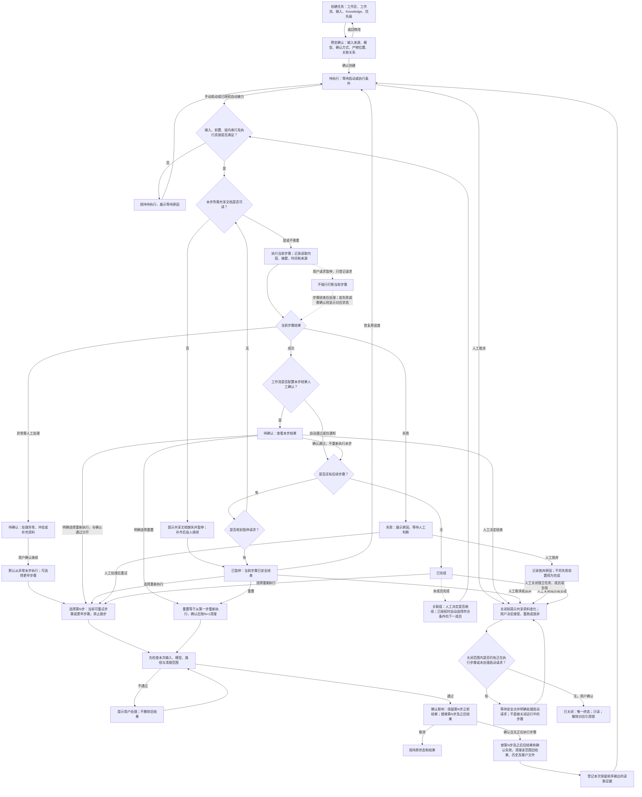
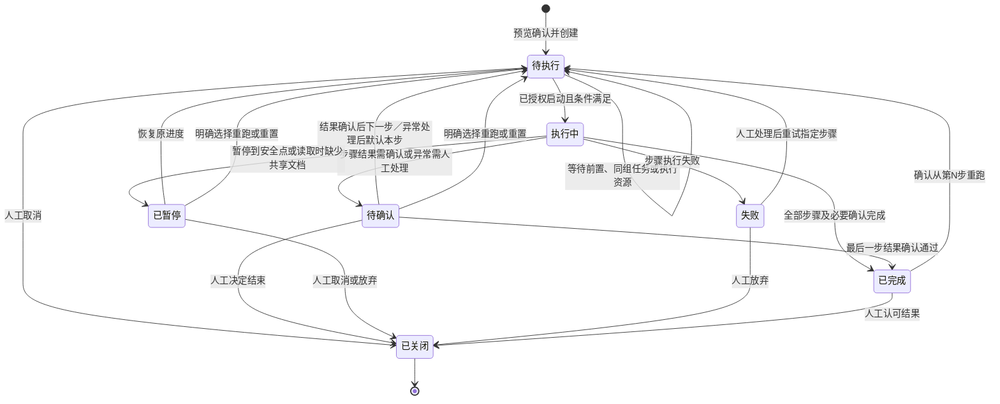

# 任务动作流程与状态流图

确认基线：2026-10-23；与 [完整产品设计](PRODUCT_DESIGN.md) 第 10 章和 [架构规范](ARCHITECTURE.md) 配套。本文为目标设计，不代表代码已实现。

## 一、任务动作流程

图中的“当前任务”和“下一关联成员”是不同任务实例，不是把已完成任务改回执行中。每次实际开始步骤前均重新检查组内资格。等待确认的本组占位不占用其他组的本机执行槽。

## 二、任务状态流

仅 7 个状态。恢复、继续或重跑先经过待执行校验；有资源时可立即进入执行中，不能在等待时虚报执行中。重置、暂停请求、放弃标记、资料变化均是动作或原因，不增加顶层状态。

## 图的解释规则

- 人工确认有两类：工作流步骤间的结果确认，以及异常人工处理；确认通过不隐含重跑。
- 暂停不强行打断当前步骤。步骤结束时失败则显示失败，需要处理则显示待确认，成功且后面还有步骤时才落入已暂停；已到流程末尾则正常完成。
- 同组串行，其他组与独立任务可并行。组内正在执行的 B 必须结束或到达安全暂停点，A 的重跑才能实际开始；用户明确切换组内执行任务，不能在暂停后让两个成员同时恢复。
- 从 N 重跑保留 1…N−1 的有效输出和确认；N 及之后旧结果、确认与客户文件被清理／替换，不作为可回退的有效结果。清理只针对系统登记的本任务对应步骤文件；新执行失败也不能恢复旧结果冒充成功。保留前序输出被再次使用时登记本次读取证据。
- 重置是 N=1。正在执行时先请求安全暂停，不能边运行边清理。
- 关联成员完成、放弃、是否继续以及关闭范围由人判断；不强制全组技术成功。人工判断与实际技术结果分开。自动接力只在已授权且前置完成等条件满足时发生；用户确认继续只恢复当前任务，失败／放弃不放行后置，启动按钮与后端均校验。
- 关闭一律人工；前置接力以完成为门，不以关闭为门。关闭成员／全组不能中断正在执行步骤，已关闭不可重开。
- 优先级只影响列表展示，按“创建时间＋优先级”组合排序，不参与调度；执行中和已关闭不可修改。
- 模型更换先影响预览；待执行任务可重新解析。其他未关闭任务提示重置、安全暂停或手工处理。安全暂停后目标模型仅作用于尚未执行步骤；要重做已执行步骤须显式从对应步骤重跑。该受控例外不允许编辑内置包或绕过其他引用锁。

## 2026-10-23 补充约束

- 异常处理后默认从异常本步执行，用户可选更早步骤；正常结果确认通过仍进下一步。
- 重跑在清理之前先检查输入、模型、路径和范围，再由用户确认；不先删后查。
- 技能／工作流配置错误进入失败，原因可见；修复后由人选起始步骤。原任务更换工作流仅记为后续需求，不在本期实现。锁定配置的必要修复入口留到对应模块开发确认。
- 共享文档需要时才读取，缺失就暂停并提示；补齐后由用户继续，不自动使用失效旧结果或跳步。
- 系统解释事实与影响，不替用户决定应从哪一步重跑。职业用户主导业务判断，流程保持简单，必要约束由按钮和后端一致执行。
