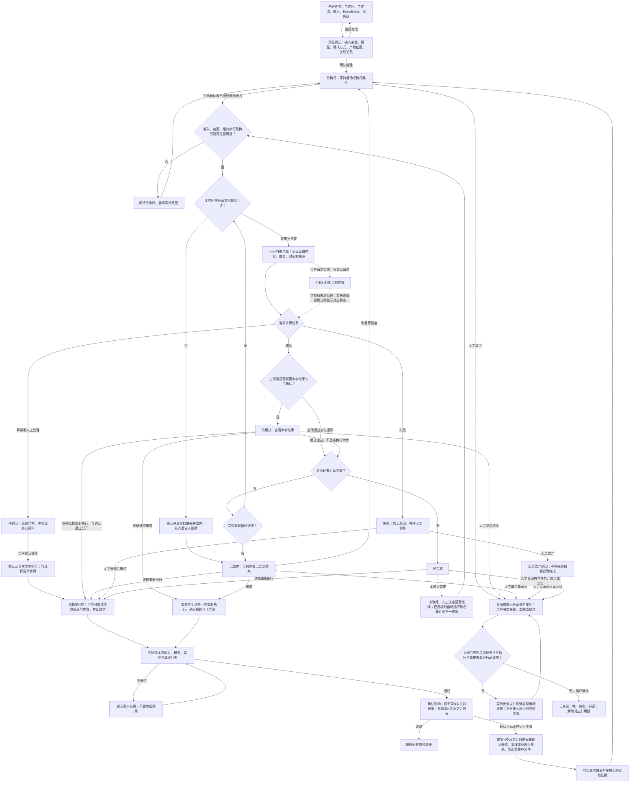
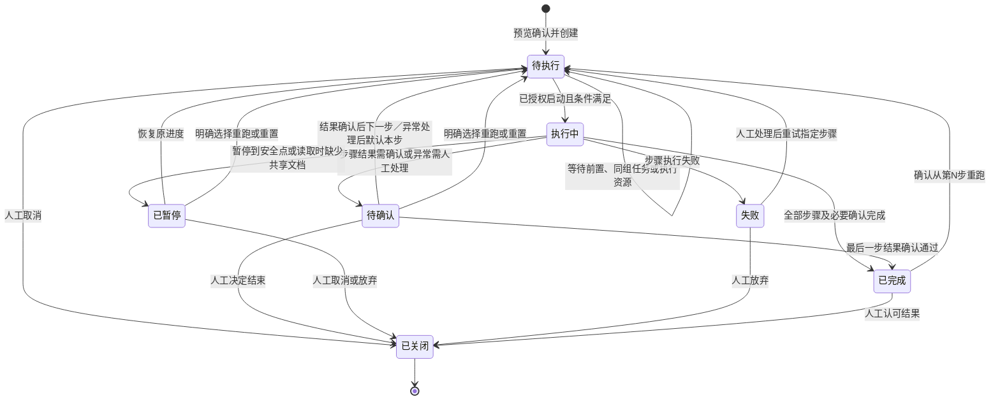

# 任务动作流程与状态流图

确认基线：2026-10-23；与 [完整产品设计](PRODUCT_DESIGN.md) 第 10 章和 [架构规范](ARCHITECTURE.md) 配套。本文为目标设计，不代表代码已实现。

## 一、任务动作流程

图中的“当前任务”和“下一关联成员”是不同任务实例，不是把已完成任务改回执行中。每次实际开始步骤前均重新检查组内资格。等待确认的本组占位不占用其他组的本机执行槽。

## 二、任务状态流

仅 7 个状态。恢复、继续或重跑先经过待执行校验；有资源时可立即进入执行中，不能在等待时虚报执行中。重置、暂停请求、放弃标记、资料变化均是动作或原因，不增加顶层状态。

## 图的解释规则

- 人工确认有两类：工作流步骤间的结果确认，以及异常人工处理；确认通过不隐含重跑。
- 暂停不强行打断当前步骤。步骤结束时失败则显示失败，需要处理则显示待确认，成功且后面还有步骤时才落入已暂停；已到流程末尾则正常完成。
- 同组串行，其他组与独立任务可并行。组内正在执行的 B 必须结束或到达安全暂停点，A 的重跑才能实际开始；用户明确切换组内执行任务，不能在暂停后让两个成员同时恢复。
- 从 N 重跑保留 1…N−1 的有效输出和确认；N 及之后旧结果、确认与客户文件被清理／替换，不作为可回退的有效结果。清理只针对系统登记的本任务对应步骤文件；新执行失败也不能恢复旧结果冒充成功。保留前序输出被再次使用时登记本次读取证据。
- 重置是 N=1。正在执行时先请求安全暂停，不能边运行边清理。
- 关联成员完成、放弃、是否继续以及关闭范围由人判断；不强制全组技术成功。人工判断与实际技术结果分开。自动接力只在已授权且前置完成等条件满足时发生；用户确认继续只恢复当前任务，失败／放弃不放行后置，启动按钮与后端均校验。
- 关闭一律人工；前置接力以完成为门，不以关闭为门。关闭成员／全组不能中断正在执行步骤，已关闭不可重开。
- 优先级只影响列表展示，按“创建时间＋优先级”组合排序，不参与调度；执行中和已关闭不可修改。
- 模型更换先影响预览；待执行任务可重新解析。其他未关闭任务提示重置、安全暂停或手工处理。安全暂停后目标模型仅作用于尚未执行步骤；要重做已执行步骤须显式从对应步骤重跑。该受控例外不允许编辑内置包或绕过其他引用锁。

## 2026-10-23 补充约束

- 异常处理后默认从异常本步执行，用户可选更早步骤；正常结果确认通过仍进下一步。
- 重跑在清理之前先检查输入、模型、路径和范围，再由用户确认；不先删后查。
- 技能／工作流配置错误进入失败，原因可见；修复后由人选起始步骤。原任务更换工作流仅记为后续需求，不在本期实现。锁定配置的必要修复入口留到对应模块开发确认。
- 共享文档需要时才读取，缺失就暂停并提示；补齐后由用户继续，不自动使用失效旧结果或跳步。
- 系统解释事实与影响，不替用户决定应从哪一步重跑。职业用户主导业务判断，流程保持简单，必要约束由按钮和后端一致执行。

## 2026-10-29 资料满足检查与任务入口待定补充

技能编写及发布时，只检查是否说清所需资料和资料不足时的处理方式，不要求真实附件，不验证真实资料内容。自由文字要求的完整性提示不能视为程序已经准确判断业务资料充分。

任务调用或工作流步骤实际调用技能时，检查已登记的真实资料；若缺少必需资料，或读取后发现缺少继续工作所必需的信息，必须进入任务“待确认”，明确缺项及补充提示。即使步骤设置为无需确认／自动通过，也不能绕过此异常确认。不得猜测、编造缺失内容，不额外增加逐份资料审批流程；可选补充资料未提供不当然阻塞。正常等待前序步骤产出不等于资料缺失，不在编写／发布时要求前序结果已经存在。复用现有待确认处理流程，处理后默认从本步执行，用户可按既有规则选择更早步骤。

任务是否允许直接选择单个技能执行尚未决定。此前关于单技能任务的建议不是已确认需求，不新增任务入口、不据此扩展执行实现；任务模块实施前必须向用户重新确认。任务内临时串联多个技能的范围也不据此开放，届时一并明确边界。

## 技能编写与调用：最新确认的模块边界

本节覆盖此前可选资料缺省可直接继续、人工可授权绕过必需资料、示例必须才能发布等讨论建议。仅记录设计，未代表正式实现。

- 技能模块：第二步使用一个主要编写区，以Markdown章节引导写清目标、必需／非必需资料及缺失影响、工作方法、结果内容、规则与验收。标题与顺序不作强制检查；不绑定真实附件、路径、来源、交付模板或一般文件数量。必要的业务格式限制可说明。示例推荐提供，不是统一发布硬门槛；有示例不等于执行验收通过。编写／发布仅检查要求是否说明，不检查真实资料。
- 工作流模块：显式编排技能、绑定任务资料和前序输出，配置实际交付形式与可选模板；技能内编号不自动成为可调度或可独立重跑的工作流步骤。自由正文不能视为已可靠解析出输入输出接口，正式绑定及识别方案在工作流实施时确认。不猜测资料来源，不限制只能读取紧邻上一步。
- 任务及执行模块：执行前尽量一次检查所有实际输入，统一展示缺失清单、缺失影响和建议处理方式。必需资料缺失阻止执行，补齐后重查，不能用确认继续绕过；非必需资料缺失由用户统一选择补充或按说明继续。需要处理时进入既有待确认，即使配置无需确认也不能跳过；不逐项审批。记录确认，未变化的相同缺口不重复问。读取中才发现的必要内容缺口按同样规则处理，不能承诺启动前识别所有内容问题。正常等待前序产出与缺失分开。
- 输出中的“待确认事项”是业务产物，不自动改变任务状态。例如需求理解产出的澄清问题清单可正常交付；无法完成当前技能目标的资料缺口才走上述资料处理。
- 任务维护实际交付位置和形式，工作流可配置步骤交付要求；技能说明结果内容与必要约束。格式能力及冲突须如实提示，不能承诺任意转换。
- 后续任务模块须重新向用户确认是否直接调用单个技能、是否允许任务内串技能；目前不确定，不增设入口。Chat附件／文字仍需确认登记为任务资料，模型选择、引用锁、证据及安全点规则不变。

编写正文模板见 docs/skill-writing-template.md。模板为编辑指导，不是已发布技能包或运行测试数据。
